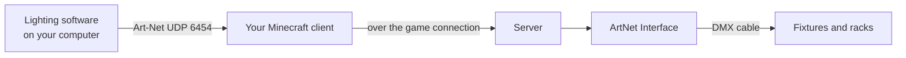
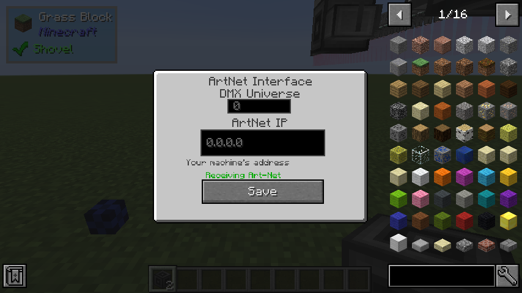

# Art-Net from real software

The **ArtNet Interface** turns Art-Net, the network protocol real lighting consoles and software
speak, into DMX in the game. Program your rig in [QLC+](https://www.qlcplus.org/), on a real
console, or in anything else that outputs Art-Net, and the fixtures in Minecraft follow.

## How it works

Art-Net arrives on **your own computer**, the one running the game, on UDP port **6454**. The
interface you place listens through your client and forwards what it hears to the server, which
drives the rig for everyone.

That has two consequences:

- **Only the player who placed an interface feeds it.** Other players' games ignore it.
- **On a server, that player must be an operator.** Art-Net is the one input that comes from
  outside the game, so the server only takes it from a trusted player. A non-operator's
  interface still shows *Receiving Art-Net* on their screen, but the server ignores the data.

In singleplayer you are both, so it simply works.

## Setting it up

1. Place an **ArtNet Interface** and run DMX cable from it to your fixtures or racks.
2. Right-click it.

    

    DMX Universe
    :   The Art-Net universe to listen to, matching the universe your software outputs.

    ArtNet IP
    :   Which network address on your computer to listen on. Leave it at **`0.0.0.0`**, which means
        every network interface, unless you know you need one in particular. A real console
        usually *broadcasts* Art-Net, and only `0.0.0.0` hears broadcasts.

3. Press **Save**.
4. In your lighting software, enable Art-Net output on the same universe, sending to your own
   computer (`127.0.0.1`) or to your network's broadcast address.

When data arrives, the screen's status line turns green and says **Receiving Art-Net**.

## Things to know

- **One program per port.** Only one program on a computer can listen on UDP 6454 at a time.
  While an interface is in view, LDEncore holds the port; it lets go when you remove the
  interface or leave the world. If your lighting software also wants to *receive* Art-Net on the
  same machine, one of them will miss out.
- **Changing the address takes effect at once.** Save a new universe or IP and the interface
  switches over, releasing the old socket.
- **If the feed stops**, the fixtures keep the last values your software sent, as most real
  Art-Net nodes do. Cutting the DMX cable after the interface, or removing the interface, blacks
  them out.
- The default address for new interfaces is set by `artnet.defaultListenAddress` in the
  [configuration](../reference/configuration.md).
