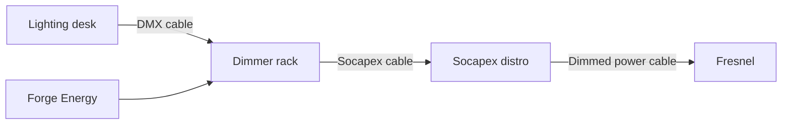
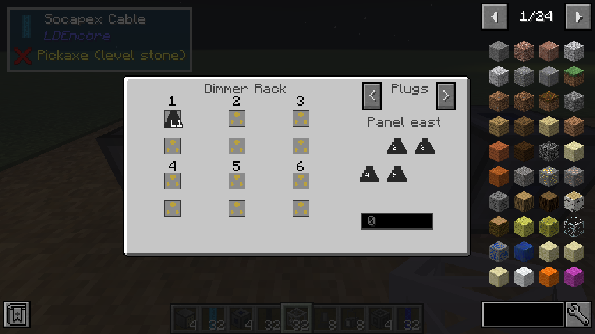

# Your first lit fresnel

A fresnel is a conventional light: it has no brain, and its brightness is simply how much power
it gets. To dim one from a desk you put a **dimmer rack** in between, exactly as in a real theatre.

You will need: a truss, a fresnel, a basic lighting desk, a dimmer rack, a socapex distro, some
DMX cable, socapex cable and dimmed power cable, and a **Forge Energy** source from another mod (a
generator, a battery, an Immersive Engineering capacitor...).

## 1. Hang the fresnel

Build a short bar of truss and place the fresnel against its underside. See
[Rigging](rigging.md) for details.

## 2. Place the dimmer rack and power it

Put the dimmer rack down and give it Forge Energy. It accepts energy on **every face**, so a
generator or battery that outputs on the side touching the rack works with no cables at all. Any
mod's FE cable works too.

## 3. Run socapex cable to a distro

A **socapex cable** carries six dimmed circuits at once. Run one from the rack to a **socapex
distro**, a breakout box that splits it back into individual sockets.

!!! warning "The distro has an input side"

    A distro takes socapex on **one face only: the face that points back at you when you place
    it**. Place it while standing on the cable side, looking at the spot it goes in. The other
    five faces are its sockets.

    If the socapex cable visibly refuses to join the distro, it is facing the wrong way. Turn it
    with the [wrench](rigging.md#the-wrench) or place it again.

## 4. Run dimmed power to the fresnel

From one of the distro's sockets, run **dimmed power cable** up to the fresnel. Each socket feeds
**one** light.

## 5. Patch the rack

Right-click the dimmer rack. On the left are its **six dimmers**. On the right are the **plugs**
of each distro it can reach, one page per face of the rack that a socapex run leaves from (the
`<` and `>` buttons page through them).

Click a plug, then click a dimmer. The dimmer now shows the plug's label, for example `E1`: panel
east, socket 1.

The number field at the bottom is the rack's **DMX start address**. Its six dimmers listen on that
address and the five after it.

## 6. Feed it DMX

Run **DMX cable** from a [lighting desk](lighting-desk.md) to the rack. With the rack's start
address at `0`, desk fader 1 drives dimmer 1, fader 2 drives dimmer 2, and so on. Raise fader 1:
the fresnel lights, and the room brightens as you push it up.

!!! tip "Testing without a generator"

    Set `fixtures.consumePower` to `false` in the [configuration](../reference/configuration.md)
    while you build. Note that this frees **moving heads** from needing power; the dimmed-power
    chain to a fresnel still needs the rack to be powered.
