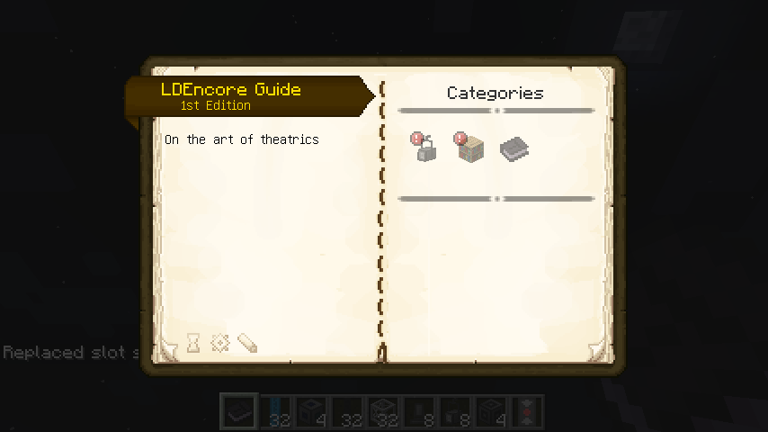
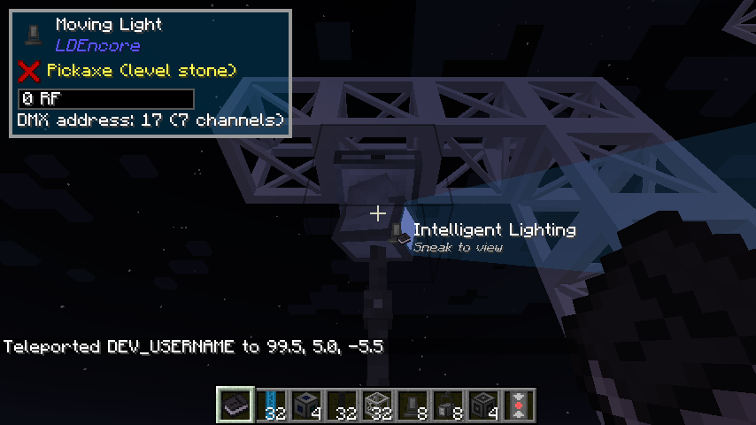

# Installation

## What you need

| | |
|---|---|
| **Minecraft** | 1.12.2 |
| **Mod loader** | Forge 14.23.5 (the final 1.12.2 line) |
| **Required mods** | None. The Art-Net library LDEncore uses is bundled inside the jar. |

Download the jar, `LDEncore-1.12.2-<version>.jar`, from the
[Releases page](https://github.com/Mica-Technologies/LDEncore/releases), pick the newest entry
that is **not** marked *Pre-release*, and put it in your `mods` folder. It goes on both the client
and the server.

!!! note "Pre-releases"

    Every change to the mod publishes a pre-release. They are fine for trying something out, but
    they can be removed after 90 days, so do not point a modpack at one.

## Optional mods worth adding

Neither is required, and the mod runs normally without them. You simply lose what they add.

[Patchouli](https://www.curseforge.com/minecraft/mc-mods/patchouli)
:   Adds the **LDEncore Guide**, an in-game book in the LDEncore creative tab, with chapters on
    the glossary, command and control, dimmers, intelligent lighting and rigging, and the
    recipes for the main blocks.

    

[The One Probe](https://www.curseforge.com/minecraft/mc-mods/the-one-probe)
:   Adds an overlay when you look at a block: a fixture's or rack's **DMX address and channel
    count**, a block's stored power, and how many of a distro's socapex channels are live. Sneak
    to see each channel's current value.

    

[JEI](https://www.curseforge.com/minecraft/mc-mods/jei)
:   Not specific to this mod, but the easiest way to look up every recipe.

## Compatibility with Theatrical

The mod id is still `theatrical`, and every block and item keeps upstream's name. In game the mod
calls itself **LDEncore** (mod list, creative tab, guide title), but saves, packs and configs that
name `theatrical` keep working.

## On a server

Install the same jar on the server and every client. Nothing extra is needed. The Art-Net
interface is the one block that talks to something outside the game, so on a server it accepts a
feed only from the player who placed it, and only if that player is an operator. See
[Art-Net](art-net.md).
