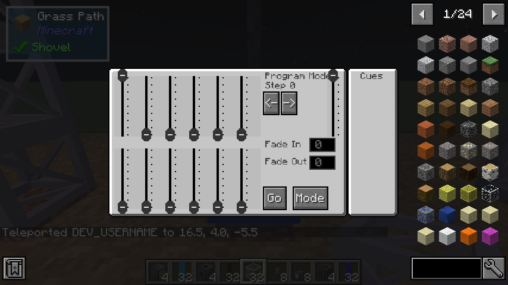

# The lighting desk

The **Basic Lighting Desk** is a small manual console: twelve channel faders, a grand master, and
a cue stack with fade times. Run DMX cable from it to your fixtures or dimmer racks.

## Faders

The twelve faders on the left send **DMX channels 0 to 11** of the desk's universe. The tall
fader on the right is the **grand master**, which scales all twelve. With the grand master at the
bottom, the desk sends nothing.

Drag a fader up to raise its channel. The physical faders on the desk block in the world move with
them, so everyone can see the state of the desk at a glance.

## Program mode: recording cues

The label at the top of the controls says which mode the desk is in. In **Program Mode**:

1. Set the faders to the look you want.
2. Set **Fade In** and **Fade Out**, in ticks (20 ticks is one second), if this cue should fade.
3. Press **Go** to record the faders as the cue at the current **step**. The desk moves on to the
   next step.

The `<-` and `->` buttons move between steps. Stepping onto a step that already holds a cue loads
its faders, so you can adjust and re-record it. The **Cues** list on the right shows what is
stored.

## Run mode: playing a show

Press **Mode** to switch to **Run Mode**. Now **Go** plays the next stored cue: the previous cue
fades out over its fade-out time while the new one fades in over its fade-in time. When the last
cue has played, Go wraps round to the first. `<-` and `->` choose which cue plays next without
playing it.

Press **Mode** again to go back to programming.

## Which channels drive what

| Desk fader | DMX channel | Typical use |
|---|---|---|
| 1 | 0 | Dimmer 1 of a rack at address 0, or intensity of a head at address 0 |
| 2–4 | 1–3 | Dimmers 2–4, or a head's red, green, blue |
| 5 | 4 | Dimmer 5, or a head's focus |
| 6 | 5 | Dimmer 6, or a head's pan |
| 7 | 6 | A head's tilt |
| 8–12 | 7–11 | A second head at address 7 (its intensity and colour) |

Twelve channels is enough for one moving head plus a rack, or two racks. For bigger rigs, drive
the fixtures from real software over [Art-Net](art-net.md).

## With several players

The desk is shared. Any player can open it, and a change one player makes shows up live in
everyone else's open screen.
