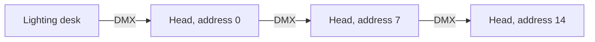
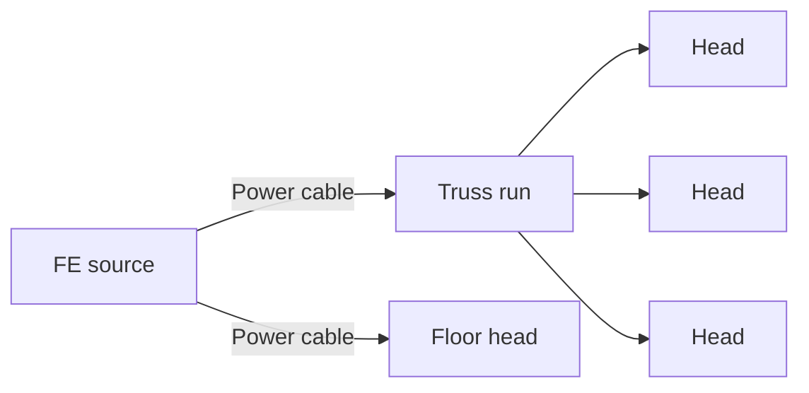

# Moving heads

A moving head is an intelligent fixture: it reads DMX directly and has motors for pan and tilt, a
colour mix and a focus. Its beam reaches up to **50 blocks** (a fresnel's reaches 25) and puts real
light where it lands.

## Wiring

Run **DMX cable** from a [desk](lighting-desk.md) or [Art-Net interface](art-net.md) into the
head. DMX passes **through** a head, so you can chain heads: cable into the first, cable out of it
to the next, and so on. Every head on the run sees the whole universe and picks out its own
channels by its address.

## Power

A moving head needs **Forge Energy** from another mod: it holds 2,000 FE and uses **50 FE every
tick** (1,000 FE a second) while it is lit, and does nothing at all without it. It accepts energy on
any face.

You do not need a source beside every head:

- **Truss and IWB are wired.** Feed any block of a truss run or bar, and every head touching that
  run gets power. A run is every truss and IWB block that touches another, so one feed powers a
  whole bar, and a separate bar needs its own feed or a cable to it.
- **Power Cable carries Forge Energy.** Run it from a generator or storage block to a truss, a
  bar or a head, for example to reach heads standing on the floor. It connects to anything that
  takes or gives FE, and pulls from storage blocks that do not push their energy out.

Nothing is stored or lost along the way: whatever the source can deliver goes to the heads that
need it, then to any dimmer racks on the same run. A source pushed straight into a truss or bar
has to push its energy out by itself (most generators and batteries do); one that only gives
energy when asked needs a Power Cable between it and the truss.

For building and testing, set `fixtures.consumePower` to `false` in the
[configuration](../reference/configuration.md) and heads run without power.

## Setting the address

Right-click the head and type its **DMX start address**. A head uses **seven channels**, starting
at its address. Give each head its own block of seven (0, 7, 14, ...) to control them separately,
or the same address to have them mirror each other.

## The seven channels

| Offset | Channel | 0 | 255 |
|---|---|---|---|
| +0 | **Intensity** | Off | Full |
| +1 | **Red** | | Full red |
| +2 | **Green** | | Full green |
| +3 | **Blue** | | Full blue |
| +4 | **Focus** | Narrowest beam | Widest beam |
| +5 | **Pan** | 0° | 360°, a full turn |
| +6 | **Tilt** | Out level, the way the head faces | Swung round past straight down |

!!! tip "Why is my head lit but the beam black?"

    Intensity alone is not enough: with red, green and blue at 0 the beam has no colour. Bring
    up all three for white. A desk with only fader 1 up gives a lit head with a black beam.

!!! tip "Pointing it at the floor"

    Tilt has a shallow working range. About **128** points a hanging head straight down; 0
    points it out level. Full-scale DMX on every channel aims the beam at the sky, not the stage.

## If it stops responding

- A head whose DMX is **cut off** (cable broken, desk removed) goes **dark** within about a second,
  and comes back as soon as the run is whole again.
- A head that is lit but not moving may simply have nothing changing on its channels.
- See [Troubleshooting](../reference/faq.md) for the rest.
