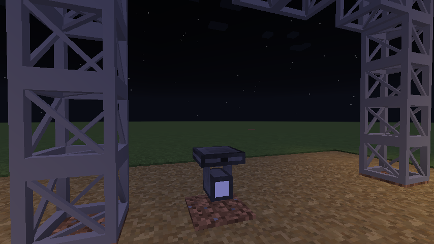

# Rigging and hanging lights

Lights hang **beneath** a support. Two blocks count as a support:

MT100 Truss
:   Box truss. Place it like a log: it runs along the axis you place it on, so you can build
    goal posts, bars and towers.

Internally Wired Bar (IWB)
:   A slimmer lighting bar. **Right-click an IWB while holding a light** to hang the light
    directly under it, facing the way you are looking.

## Hanging a light

Place a fresnel or a moving head against the **underside** of a truss or IWB block. It faces the
direction you were looking when you placed it.

- A **fresnel** can only hang. It cannot be placed anywhere without a support above it.
- A **moving head** can hang, or stand on any solid floor. Place it from above onto the floor to
  stand it up.

## When the support goes

Break the truss or bar a light hangs from and the light **falls**. It lands **broken**, and its
item says *Broken!* when you pick it up. A falling light hurts whatever it lands on; a helmet
halves the damage.

A broken light no longer lights anything up. Repair it on a crafting grid (shapeless):

| Broken | Add | Gives |
|---|---|---|
| Fresnel | Tungsten Bulb | Working fresnel |
| Moving head | Electrical Motor + LED | Working moving head |

If a falling light lands somewhere it cannot be placed, it drops as a broken item instead, so it
is never lost.

## Aiming a fresnel

A fresnel has no motors, so you aim it by hand. Right-click it to open its screen, which has
**pan** and **tilt** sliders.

The **Remote Light Positioner** is quicker for a whole rig:

1. Right-click a fresnel with the positioner. The fresnel now **follows you**.
2. Walk to where you want the light to point.
3. Right-click the fresnel again, or **sneak and right-click** anywhere, to let go. It keeps the
   aim it had.

Moving heads are aimed over DMX instead. See [Moving heads](moving-heads.md).

## The wrench

The **Wrench** rotates blocks that support rotation, the same way a wrench from other tech mods
does. Use it to turn a desk, rack or distro around without breaking it.
