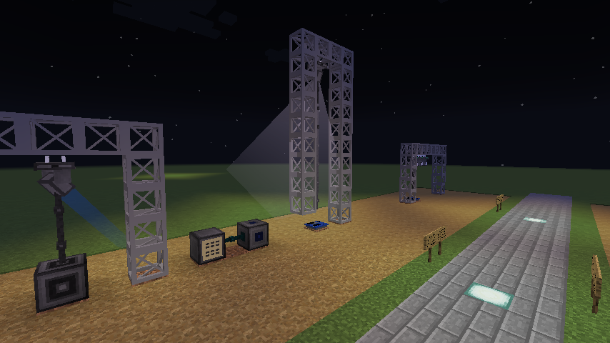
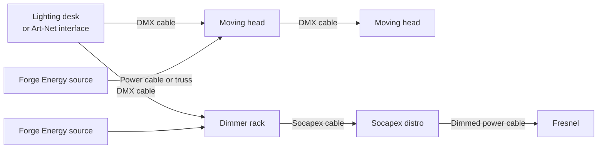

# LDEncore

Live-event lighting for Minecraft. Hang fresnels and moving heads from truss, run DMX from a
lighting desk or from real lighting software on your computer, dim conventional lights through a
dimmer rack, and watch the beams land on your set.

This wiki covers **LDEncore**, Mica Technologies' unofficial **Minecraft Forge 1.12.2** port of
[Theatrical](https://github.com/theatricalmod/theatrical-forge) by Rushmead and the Theatrical
Team.

!!! danger "This is not the official Theatrical mod"

    This fork is **not affiliated with, endorsed by, or supported by the Theatrical team**, and
    the builds published here are not theirs. **Do not report problems with this fork upstream**:
    they did not write the 1.12.2 port and cannot support it.

    Full detail: [This is a fork](about/fork.md).

## Where to start

-   :material-download: **[Installation](guide/installation.md)**

    What you need, the two optional mods worth adding, and where the jar comes from.

-   :material-ceiling-light: **[Your first lit fresnel](guide/first-rig.md)**

    Truss, a fresnel, a dimmer rack and a distro, from nothing to a light you can dim.

-   :material-spotlight-beam: **[Moving heads](guide/moving-heads.md)**

    Colour, pan, tilt and focus over DMX, and the power a head needs.

-   :material-tune-vertical: **[The lighting desk](guide/lighting-desk.md)**

    Faders, cues with fades and holds, effects, and shows that run by themselves.

-   :material-lan: **[Art-Net](guide/art-net.md)**

    Drive the rig from QLC+, a real console, or anything else that speaks Art-Net.

-   :material-cube-outline: **[Blocks and items](reference/blocks.md)**

    Everything the mod adds and what each one is for.

## How a rig fits together

There are two kinds of light, and they are wired differently:

- A **moving head** is an intelligent fixture: it reads DMX itself, so the DMX cable goes straight
  into it, and from one head on to the next. It also needs its own power.
- A **fresnel** (the generic light) knows nothing about DMX. It is a plain lamp whose brightness is
  the power it is fed, exactly like a real tungsten fixture on a dimmer. The DMX goes to a
  **dimmer rack**, which turns six DMX channels into six dimmed circuits.

## What this fork adds over Theatrical

The 1.12.2 port is the whole of upstream's last release, Theatrical 0.7.2 for Minecraft 1.16.4,
translated to Forge 1.12.2, plus fixes found along the way. Among the differences you may notice:

- An Art-Net interface listens on every network interface by default, so a real console's
  broadcast reaches the game, and its screen says whether anything is arriving.
- A fixture cut off from its DMX goes dark instead of freezing on its last look, so a broken run
  is visible.
- A lighting desk can run a show on its own: looping cue stacks with hold times, auto-start
  that survives a restart, redstone and time-of-day triggers, an effects engine, and the
  `/encore` command.
- An idle rig costs nothing: fixtures stop re-tracing their beams when nothing has changed.
- Many upstream bugs are fixed, including a dimmer rack that ignored every address but 0, cables
  that forgot their connections on reload, and a fixture that would not dim unless it also moved.

The full list is in the repository's
[`CHANGELOG-FORK.md`](https://github.com/Mica-Technologies/LDEncore/blob/1.12/CHANGELOG-FORK.md).
